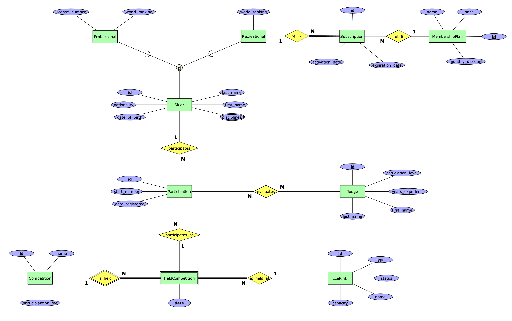

# Database Schema — Lab 03

## ER Diagram



## Relational Schema

```text
Skier(id, first_name, last_name, nationality, date_of_birth)
Skier_Discipline(skier_id*, discipline)
Professional(skier_id*, license_number, world_ranking)
Recreational(skier_id*, world_ranking)
Membership_plan(id, name, price, monthly_discount)
Subscription(id, recreational_id*, membership_plan_id*, activation_date, expiration_date)
Ice_Rink(id, name, type, status, capacity)
Competition(id, name, participation_fee)
Held_Competition(competition_id*, date, ice_rink_id*)
Participation(id, skier_id*, competition_id*, held_date*, start_number, date_registered)
Judge(id, first_name, last_name, certification_level, years_experience)
Evaluates(participation_id*, judge_id*)
```
